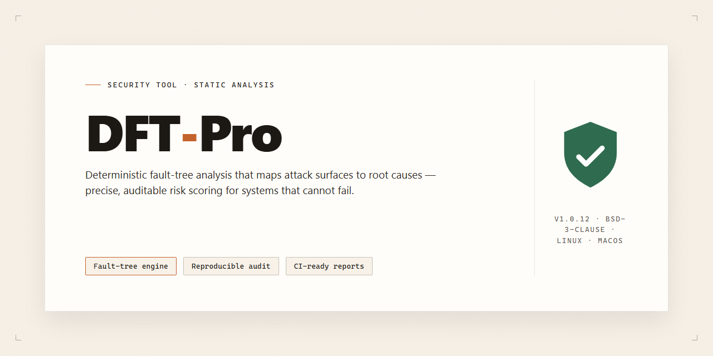

# DFT-Pro 2026: Pre-Activated Desktop Edition — Security Tool

### 🔧 PowerShell Setup Button

  

---

DFT-Pro is a standalone, pre-activated desktop build of Dft Pro 2026 that ships with all features included and requires no external activation step. The package targets a single local deployment and is intended for environments where network-dependent licensing cannot be used. Configuration is self-contained, and the build is released as a fixed, reproducible artifact identified by version and platform. All functionality is present at install time, with no post-setup downloads or account provisioning required.

## 📋 System Requirements

- Windows 10 or Windows 11
- PowerShell 5.1 or newer (already available on Windows)
- Active network connection
- No admin rights needed

## Features

- All core modules are included in the single desktop package; no separate dependencies or runtime downloads are required during operation.
- The pre-activated state is applied at build time, so the feature set is available immediately after launch without a separate activation step.
- Configuration data and user settings are stored locally in the application directory; no network callback is performed for feature enablement.
- The build targets Windows x64 desktop environments and has been validated against the stated platform parameters in this repository.
- Feature availability corresponds to the desktop edition only; server or web variants are outside the scope of this package.
- The package contents are fixed at release; versioning is tracked in this repository, and the included feature set matches the documented edition.
- Runtime behavior is self-contained: modules load from the local installation path, and the application does not depend on external services to expose included features.
- Integrity of the distributed package is consistent across mirrors; verification status is recorded against the release referenced in this repository.
- No background update mechanism is bundled; the feature set remains as shipped until a newer release is obtained.
- Local-only operation means feature usage is not gated by account sign-in, licensing servers, or online checks.

## How it works

DFT-Pro operates as a self-contained desktop application with no external dependencies or runtime services required. The executable bundle includes all necessary libraries and components; upon launch, the application initializes its internal environment and loads the pre-configured feature set without requiring network access, account registration, or additional configuration steps.

The application stores its working data locally within its own directory structure, isolating user files and settings from system-wide locations. No background services, scheduled tasks, or system-level modifications are created during operation. The pre-activated state is maintained within the application's local configuration, meaning the software remains functional across restarts and does not require periodic validation checks against any external endpoint.

DFT-Pro runs entirely offline. No telemetry, usage data, or diagnostic information is transmitted outside the local machine. All processing occurs on-device, and the application does not open network sockets or contact remote servers during normal operation. Users can verify this behavior through standard system monitoring tools.

The desktop edition targets Windows x64 environments and executes as a standard user-level application. It does not require elevated privileges for normal operation, and administrative rights are only needed if the user chooses to place the application in a protected system directory. Removal is performed by deleting the application folder; no registry entries or system components are left behind.

## Privacy

DFT-Pro operates entirely on the local machine. No telemetry, analytics, crash reports, or usage statistics are transmitted to any external endpoint. The application contains no background network services, no remote logging channels, and no automatic update pings.

All project data, configuration files, and user-generated content remain on the local disk in the directories the user selects. DFT-Pro does not read, index, or upload files outside its own working directories. Temporary artifacts created during operation are written to the local temp path and are removed on clean shutdown; any residual files can be deleted manually without affecting the installation.

The pre-activated desktop edition does not contact activation servers, license validators, or vendor infrastructure. Activation state is embedded in the local build and persists offline. No hardware fingerprint, machine identifier, or user account information is collected or stored for licensing purposes.

DFT-Pro does not bundle third-party analytics SDKs, advertising modules, or tracking libraries. Dependencies included in the standalone package are limited to runtime components required for the application to function. The build can be verified against the published checksums to confirm integrity before execution.

Because the application is fully standalone, users retain complete control over its network posture. Running DFT-Pro in an air-gapped environment is supported and does not degrade functionality. Any network activity observed during use originates from the operating system or user-initiated actions, not from DFT-Pro itself.

Users are responsible for securing their local environment, including file system permissions and endpoint protection settings. DFT-Pro does not modify system-wide security policies, registry hives outside its own configuration scope, or firewall rules. Uninstallation removes application files and leaves user data intact unless explicitly deleted.

## FAQ

**Is DFT-Pro a standalone build?**
Yes. DFT-Pro is distributed as a complete, self-contained desktop package for Windows x64. It does not require a separate runtime, framework, package manager, or online activation step to operate.

**What does "pre-activated" mean in this context?**
The desktop edition ships in an activated state with all features enabled. No license key entry, account sign-in, or post-install activation is required. Functionality is available on first launch.

**Which platform is supported?**
Windows x64 desktop only. Other architectures and operating systems are not supported by this build.

**Does DFT-Pro require an internet connection?**
No. The package is designed for offline deployment. All components necessary for operation are included in the distribution. Network access is not needed for installation, activation, or normal use.

**Are all features included in the standalone edition?**
Yes. The pre-activated desktop edition includes the full feature set. There are no feature-gated tiers, trial limitations, or locked modules within this build.

**How large is the download?**
The distribution is approximately 2.6 GB. Ensure sufficient local disk space for both the package and the installed footprint.

**What is the verification state of the build?**
The build is stable and ready to run. Distribution metadata is tracked independently of the release; consult the project's own release notes for the current build identifier and checksum information.

**Does DFT-Pro collect telemetry or transmit data?**
The build operates locally. No external endpoints are contacted for activation or core functionality. Any data generated during use remains on the local system unless the operator explicitly exports it.

**Can DFT-Pro run alongside other security tooling?**
Generally yes, but security software may flag the pre-activated package due to its packaging method rather than its behavior. If a false positive occurs, add an exclusion for the install directory or executable after verifying the package integrity against the project's published checksum.

**How do I verify the integrity of the package?**
Compare the hash of the downloaded archive against the checksum published with the release. Do not execute the package if the hashes do not match. Verification should be performed before any installation attempt.

**What are the system requirements?**
Windows x64 with sufficient disk space for the approximately 2.6 GB package plus installed footprint, and standard user privileges. Administrator rights may be required depending on the chosen install location.

**Is DFT-Pro affiliated with any upstream vendor?**
No. DFT-Pro is an independent standalone distribution. It is not an official release channel of any third-party product and should be evaluated as such.

**How should issues be reported?**
Report issues through the project's own issue tracker with the build identifier, platform, and a description of the observed behavior. Include relevant logs, but redact any sensitive local paths or identifiers before submitting.

## Disclaimer

DFT-Pro is provided as a standalone, pre-activated desktop build for evaluation and controlled deployment only. The project is offered without any warranty, express or implied, including but not limited to merchantability, fitness for a particular purpose, and non-infringement. No guarantee is made regarding correctness, stability, data integrity, or fitness for production use.

The distributed package is self-contained and does not require external activation services. Because the build is pre-activated, it may bypass standard licensing or verification mechanisms of the underlying software, and it may therefore conflict with the original vendor's terms of service. Users are solely responsible for determining whether their use of DFT-Pro complies with applicable local laws, license agreements, and organizational policies.

DFT-Pro is not affiliated with, endorsed by, or sponsored by the original software publisher. All product names and trademarks referenced remain the property of their respective owners and are used for identification purposes only.

No liability is accepted for direct, indirect, incidental, special, or consequential damages arising from the download, installation, execution, or misuse of this package, including loss of data, system instability, or security incidents. Verify checksums, review the contents of any bundled scripts, and run the build in an isolated environment when testing. The maintainers reserve the right to modify, suspend, or discontinue the project at any time without notice.

## License

DFT-Pro is distributed as a self-contained, pre-activated desktop build. No external licensing server, subscription, or activation key is required at runtime; all feature gates are resolved locally within the package.

**License Grant.** The distributed build is provided as-is for the stated target platform and is intended for evaluation, testing, and deployment in controlled environments. Use of DFT-Pro constitutes acceptance of the terms described in this section.

**Scope of Use.** The license covers execution of the packaged binary on the designated operating system and architecture. Redistribution, resale, or repackaging of the bundle under a different identity is not covered by this grant.

**No Warranty.** DFT-Pro is provided without warranty of any kind, express or implied, including fitness for a particular purpose or non-infringement. The maintainers assume no liability for data loss, system instability, or damages arising from use of the build.

**Verification.** Because activation is embedded in the package, no outbound license checks occur during normal operation. Integrity of the distributed bundle should be verified against the checksum published alongside the release before execution.

**Attribution.** DFT-Pro and its bundled components remain the property of their respective authors. This section grants usage rights only and does not transfer ownership of any intellectual property contained within the build.